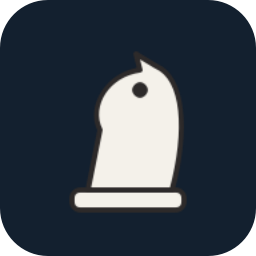
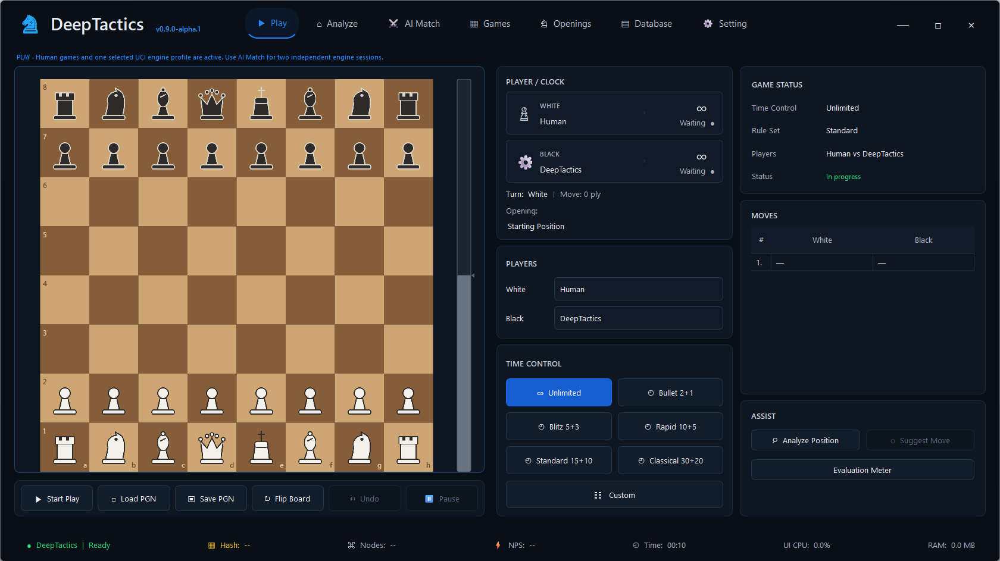

<div align="center">



# DeepTactics Chess Engine

**네이티브 C++ 탐색 코어, 셀프플레이 가중치 학습기, 현대적인 Qt 데스크톱 인터페이스를 갖춘 체스 엔진**

[](https://www.python.org/)
[](chess_engine/native/native_eval.cpp)
[](https://doc.qt.io/qtforpython-6/)
[](#uci-엔진으로-사용)
[](LICENSE)

[**← English README**](README.md) &nbsp;|&nbsp; [**한국어**](README.ko.md)

</div>

<p align="center">
  
</p>

---

## 주요 특징

- **빠른 네이티브 탐색** — 반복 심화 알파-베타, 전치표, 어스피레이션 윈도우, 널무브, 후반 수 축소(LMR), 퓨틸리티 가지치기, 정지 탐색, 킬러/히스토리 정렬, 시간 관리를 하나의 C++ 코어로 구현했습니다.
- **조정 가능한 평가 함수** — 기물 가치, 위치 테이블, 기동성, 폰 구조, 비숍 쌍, 룩 활동성, 킹 안전, 통과 폰, 엔드게임 압박 등 항목마다 독립된 가중치를 가집니다.
- **스스로 학습** — 병렬 셀프플레이로 국면 데이터를 만들고, 정규화된 학습기가 평가 가중치를 갱신합니다. 표본이 적거나 신호가 약하면 가중치가 거의 움직이지 않도록 신뢰도로 보정합니다.
- **완성형 데스크톱 GUI** — 대국, 분석, 엔진 대 엔진 매치, PGN 라이브러리, 오프닝 학습, 데이터셋 관리를 한국어/영어로 지원합니다.
- **UCI 호환** — UCI를 지원하는 어떤 GUI에서도 사용할 수 있습니다.
- **근거 중심 개발** — 탐색 변경은 모두 짝지은(paired) 셀프플레이 매치로 검증한 뒤에만 기본값으로 채택합니다.

## 기능

| 영역 | 내용 |
| --- | --- |
| **Play** | 시계와 시간 프리셋(Bullet / Blitz / Rapid / Classical), 사용자 지정 시간 설정으로 엔진과 대국 |
| **Analyze** | 실시간 평가, 주 변화(PV), 멀티 PV, 평가 그래프, 수 분류와 정확도 |
| **AI Match** | 독립된 두 엔진 프로필의 동일 오프닝 매치와 실시간 점수판 |
| **Games** | PGN 가져오기/내보내기, 검색 가능한 라이브러리, 메모와 메타데이터 |
| **Openings** | ECO 기반 오프닝 탐색, 이후 수순과 통계 |
| **Database** | 셀프플레이 데이터셋, 백그라운드 작업(학습·비교), 후보 가중치 관리 |
| **Settings** | 엔진 프로필, 탐색 옵션, 테마, 언어, 경로 |

## 기술 개요

| 구성 요소 | 상세 |
| --- | --- |
| 탐색 코어 | C++17, Python `ctypes` 연동. 반복 심화, 알파-베타, 클러스터 전치표, 어스피레이션 윈도우, 널무브, LMR, 퓨틸리티 가지치기, 체크 연장, 정지 탐색 |
| 수 정렬 | 전치표 수, MVV-LVA, 킬러 수, 히스토리 휴리스틱, 단계별 수 선택 |
| 평가 | 12개 항목에 독립 가중치를 둔 휴리스틱 평가(JSON 저장) |
| 학습 | 셀프플레이 데이터 생성, 네이티브 평가기에서 직접 특징 추출, 정규화된 가중치 갱신, 후보 가중치 짝 매치 비교 |
| 신경망 평가 | 실험적 희소 선형·어큐뮬레이터 NNUE 도구(데이터셋 생성, 학습, 바이너리 내보내기) |
| 프로토콜 | UCI(`go depth / movetime / wtime…`, `MultiPV`, `Hash`, 오프닝 북, 선택적 Syzygy 조회) |
| 인터페이스 | PySide6 데스크톱 앱, 다국어(영어/한국어) |
| 규칙 | 순수 Python 규칙 코어: 합법 수 생성, FEN, PGN/SAN, 반복·무승부 규칙 |

## 시작하기

**요구 사항:** Windows, Python 3.10+, 네이티브 코어 빌드용 C++ 컴파일러(MSVC)

```bash
# 1. GUI 의존성 설치
pip install PySide6

# 2. 네이티브 탐색 코어 빌드 (x64 Native Tools 명령 프롬프트에서)
build_native.bat

# 3. 데스크톱 앱 실행
python -m chess_engine
```

선택: `pip install chess` 를 설치하면 Syzygy 테이블베이스 조회를 쓸 수 있습니다.

### UCI 엔진으로 사용

```bash
python -m chess_engine uci
```

UCI를 지원하는 GUI에서 위 명령을 엔진으로 등록하세요.

### 학습과 도구

```bash
# 병렬 셀프플레이로 평가 가중치를 계속 갱신
python -m chess_engine train-cycle-fast --games 200 --workers 4

# 수집한 학습 데이터 요약
python -m chess_engine training-report --input artifacts/self_play_cycle.csv

# 네이티브 코어 빌드 상태 확인
python -m chess_engine native-status
```

### 실행 파일(.exe) 만들기

```bash
pip install pyinstaller
pyinstaller packaging/DeepTactics.spec --noconfirm
```

## 프로젝트 구조

```text
chess_engine/
├── chess_core/   규칙, FEN, PGN, 대국 상태
├── native/       C++ 탐색·평가 코어와 ctypes 브리지
├── ai/           평가 가중치, 수 정렬, 탐색 백엔드
├── analysis/     국면 분석과 수 분류
├── self_play/    셀프플레이 게임 생성
├── learning/     특징 추출과 가중치 학습
├── nnue/         실험적 NNUE 도구
├── rating/       Elo / Glicko 도구
├── ui/           Qt 인터페이스
├── uci.py        UCI 프로토콜 루프
└── tests/        단위 테스트
```

## 테스트

```bash
python -m unittest discover -s chess_engine/tests -t .
```

먼저 네이티브 코어를 빌드해야 합니다.

## 라이선스

[GNU GPL v3](LICENSE)로 배포됩니다. 기여를 환영합니다 — [CONTRIBUTING.md](CONTRIBUTING.md)를 참고하세요.

Copyright (C) 2026 DeepTactics-Developer
