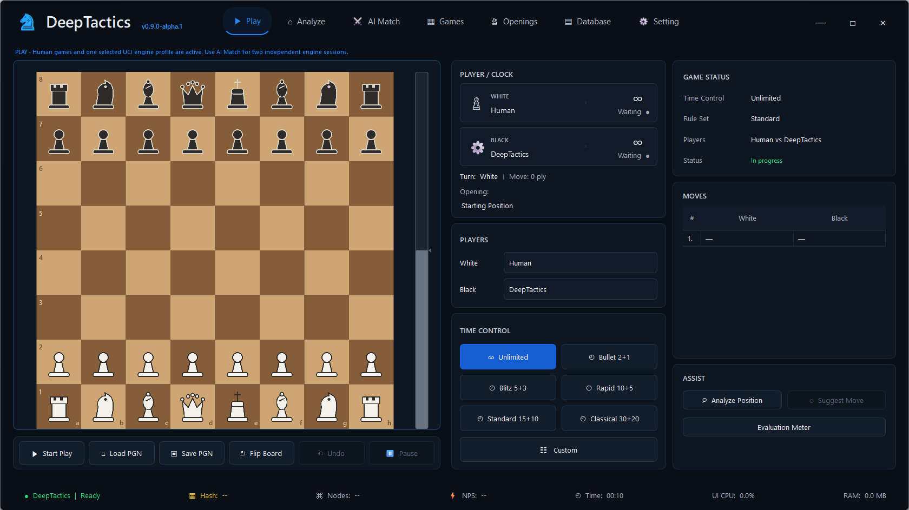

<div align="center">


# DeepTactics Chess Engine

**A chess engine with a native C++ search core, a self-play weight trainer, and a modern Qt desktop interface.**

[](https://www.python.org/)
[](chess_engine/native/native_eval.cpp)
[](https://doc.qt.io/qtforpython-6/)
[](#uci-engine)
[](LICENSE)

[**English**](README.md) &nbsp;|&nbsp; [**한국어 설명서 →**](README.ko.md)

</div>

<p align="center">
  
</p>

---

## Highlights

- **Fast native search** — alpha-beta with iterative deepening, transposition table, aspiration windows, null-move, late-move reductions, futility pruning, quiescence, killer/history ordering and time management, all in a single C++ translation unit.
- **Tunable evaluation** — material, piece-square tables, mobility, pawn structure, bishop pair, rook activity, king safety, passed pawns, endgame pressure and more, each with an independent weight.
- **Learns from its own games** — a parallel self-play loop produces positions and a regularized trainer updates the evaluation weights, with confidence scaling so small or noisy batches barely move them.
- **Full desktop GUI** — play, analyze, run engine-vs-engine matches, browse a PGN library, study openings and manage datasets, in English or Korean.
- **UCI compatible** — use the engine from any UCI GUI.
- **Evidence-driven development** — every search change is validated with paired self-play matches before it becomes a default.

## Features

| Area | What you get |
| --- | --- |
| **Play** | Human vs engine with clocks, presets (Bullet / Blitz / Rapid / Classical) and custom time controls |
| **Analyze** | Live evaluation, principal variation, multi-PV, evaluation graph, move classification and accuracy |
| **AI Match** | Two independent engine profiles play a paired-opening match with a live scoreboard |
| **Games** | PGN import/export, searchable library, notes and metadata |
| **Openings** | ECO-indexed opening explorer with continuations and statistics |
| **Database** | Self-play datasets, background jobs (training, comparison) and weight candidates |
| **Settings** | Engine profiles, search options, themes, language and paths |

## Technical overview

| Component | Details |
| --- | --- |
| Core search | C++17, exposed to Python through `ctypes`; iterative deepening, alpha-beta, clustered transposition table, aspiration windows, null-move pruning, LMR, futility pruning, check extensions, quiescence search |
| Move ordering | TT move, MVV-LVA, killer moves, history heuristic, staged move picking |
| Evaluation | Tapered handcrafted evaluation with 12 independently weighted terms; weights stored as JSON |
| Training | Self-play data generation, feature extraction straight from the native evaluator, regularized weight updates, paired-match comparison of candidate weights |
| Neural evaluation | Experimental sparse-linear and accumulator NNUE tooling (dataset builder, trainer, binary export) |
| Protocol | UCI (`go depth / movetime / wtime…`, `MultiPV`, `Hash`, opening book and optional Syzygy probing) |
| Interface | PySide6 desktop application with i18n (English / Korean) |
| Rules | Pure-Python rules core: legal move generation, FEN, PGN/SAN, repetition and draw rules |

## Getting started

**Requirements:** Windows, Python 3.10+, a C++ compiler (MSVC) for the native core.

```bash
# 1. Install the GUI dependency
pip install PySide6

# 2. Build the native search core (from an x64 Native Tools command prompt)
build_native.bat

# 3. Launch the desktop app
python -m chess_engine
```

Optional: `pip install chess` enables Syzygy tablebase probing.

### UCI engine

```bash
python -m chess_engine uci
```

Point any UCI-capable GUI at that command.

### Training and tools

```bash
# Parallel self-play that continuously updates evaluation weights
python -m chess_engine train-cycle-fast --games 200 --workers 4

# Summarize collected training data
python -m chess_engine training-report --input artifacts/self_play_cycle.csv

# Check that the native core is built and current
python -m chess_engine native-status
```

### Packaging

```bash
pip install pyinstaller
pyinstaller packaging/DeepTactics.spec --noconfirm
```

## Project layout

```text
chess_engine/
├── chess_core/   rules, FEN, PGN, game state
├── native/       C++ search + evaluation core and ctypes bridge
├── ai/           evaluation weights, move ordering, search backend
├── analysis/     position analysis and move classification
├── self_play/    self-play game generation
├── learning/     feature extraction and weight training
├── nnue/         experimental NNUE tooling
├── rating/       Elo / Glicko helpers
├── ui/           Qt interface
├── uci.py        UCI protocol loop
└── tests/        unit tests
```

## Tests

```bash
python -m unittest discover -s chess_engine/tests -t .
```

The native core must be built first.

## License

Released under the [GNU GPL v3](LICENSE). Contributions are welcome — see [CONTRIBUTING.md](CONTRIBUTING.md).
